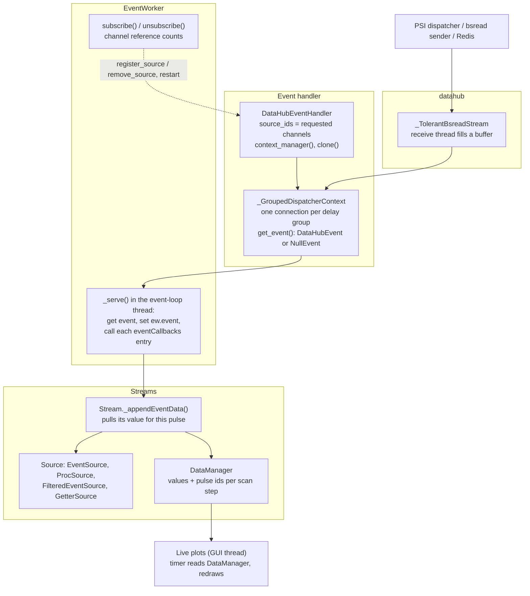
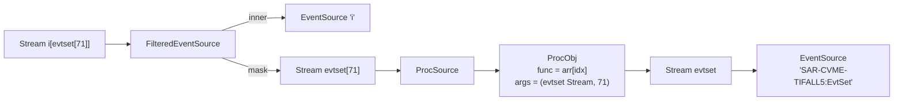
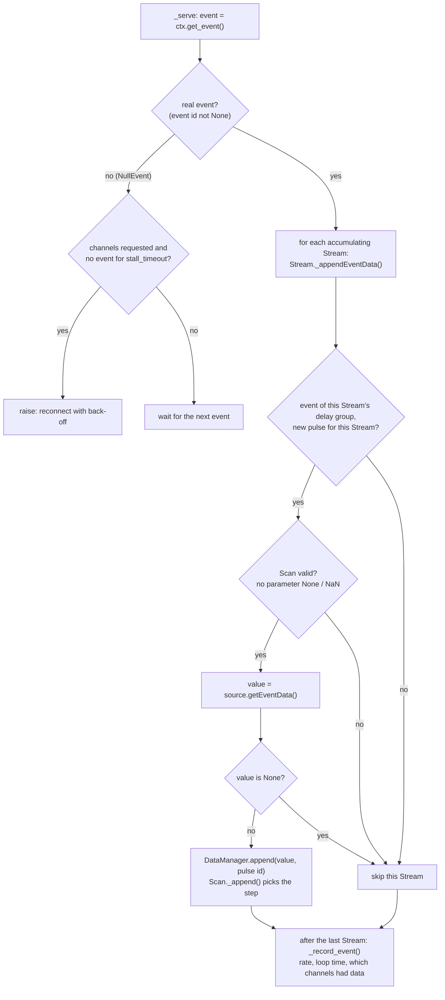
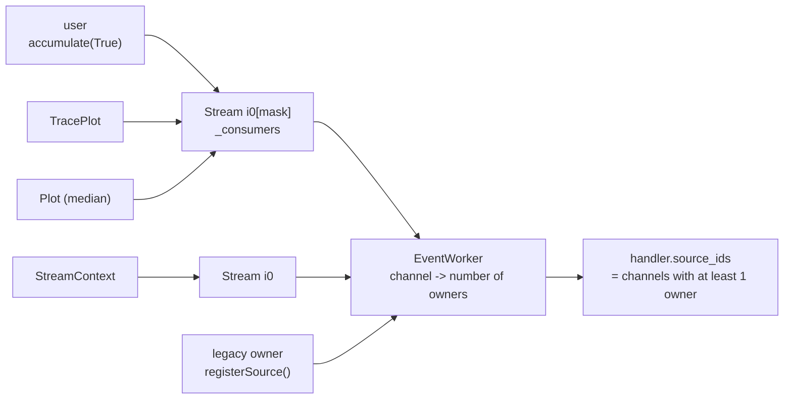
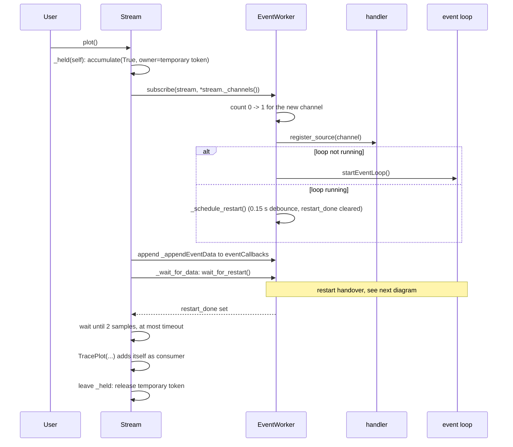
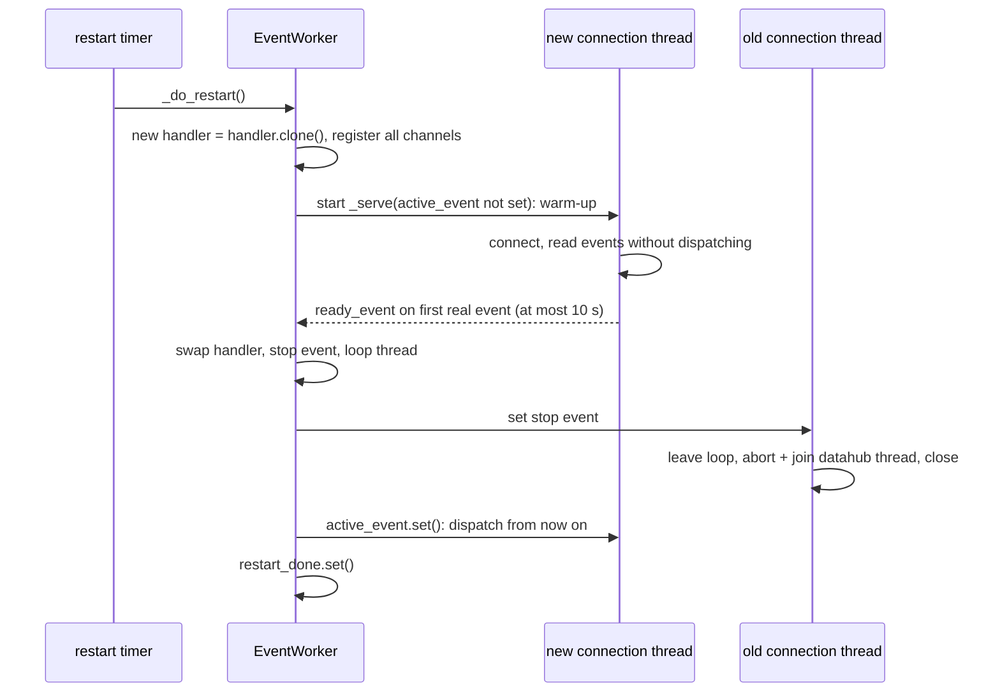
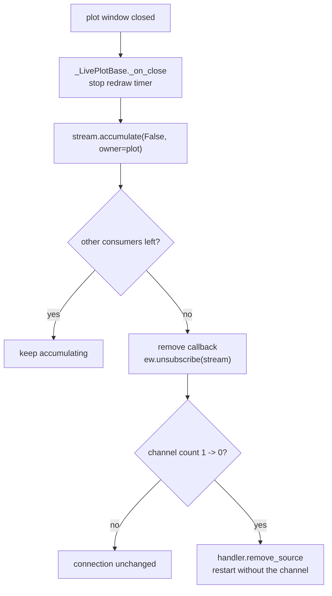
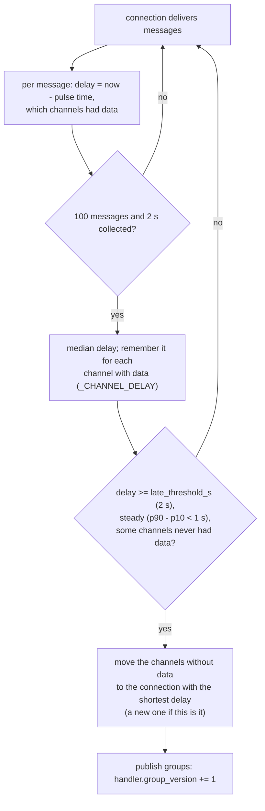

# Stream internals

This page is for people working on `escape.stream` itself: how data gets
from the dispatcher into a `Stream`, how channels are subscribed and
released, and what happens when something goes wrong. For how to *use*
Streams, see [Live-Stream Data Acquisition](../user_guide/stream.md).

Almost everything described here lives in `escape/stream/escape_stream.py`.
The datahub transport is in `escape/stream/es_wrappers_datahub.py` and the
plots are in `escape/stream/plots.py`.

## Layers

| Class | Role |
|---|---|
| `DataHubEventHandler` | Holds the list of requested channels (`source_ids`) and the current delay groups (`groups`, `group_of()`). `context_manager()` returns the context that opens the dispatcher connections. `clone()` makes an identical handler for the restart handover. |
| `_GroupedDispatcherContext` | The open dispatcher connections, one per delay group (see [Delay groups](#delay-groups)). `get_event()` returns the next `DataHubEvent`, tagged with its group, or a `NullEvent` after `receive_timeout` (0.5 s). |
| `DataHubEventSourceContext` | One plain connection: used for Redis, the local bsread sender and while no channel is subscribed. |
| `_TolerantBsreadStream` | datahub's `BsreadStream`, except that a requested channel missing from a message becomes `None` instead of ending the receive thread (see [Failure handling](#failure-handling)). |
| `EventWorker` | Runs the event loop in one background thread, owns the channel reference counts, and restarts the connection when the channel set changes. |
| `Stream` | The user object: a source plus a `DataManager`. While accumulating, its `_appendEventData` is one entry in `ew.eventCallbacks`. |
| `EventSource` | A real channel: reads `ew.event.getFromSource(name)`. |
| `ProcSource` / `ProcObj` | A derived value (`a - b`, `x[3]`, `running_mean`, `digitize`, ...). The `ProcObj` computes once per pulse; each output is one `ProcSource`. |
| `FilteredEventSource` | `x[mask]`: returns the inner value when the mask Stream is truthy on this pulse, else `None`. |
| `GetterSource` | Wraps a plain Python getter (`from_getter`). Not pulse-synchronous. |
| `Scan` / `DataManager` | `Scan` maps this pulse's parameter values to a step index; `DataManager` keeps a bounded deque of values and pulse ids per step. |

## The object graph of a derived Stream

Derived Streams don't store references to the channels they need. They form
a graph of sources, and every pulse each accumulating Stream *pulls* its
value through that graph. For `i[evtset[71]]`:

`_collect_source_channels()` walks the same graph to find the real channels
(`i` and the EvtSet channel here). `Stream._channels()` adds the channels
behind the Stream's scan parameters, e.g. the key of
`key.digitize(bins).categorize(x)`.

`stream[i]` and `stream[mask]` are cached on the parent Stream
(`_cached_derived`, weak references keyed by index or by `id(mask)` plus a
weak reference to the mask). Asking again returns the same Stream with its
data, instead of a new graph, a new buffer and a new callback.

## Per-pulse evaluation

`ProcSource.getEventData()` asks its `ProcObj`, which:

1. returns at once if it already ran for this pulse (several Streams can
   share one `ProcObj`, e.g. a Stream and the Streams derived from it);
2. reads each input for this pulse; if any is `None`, produces nothing;
3. otherwise calls `func` and remembers the pulse id that produced the result.

`ProcObj.current_values()` hands out the result only for that same pulse,
so a lower-rate input never repeats an old value onto later pulses. The
exception is `hold_last=True`, used by the running statistics, which return
their last value on every pulse.

## Subscribing: from `plot()` to the first data

Two levels of ownership are involved:

- **Stream consumers** (`stream._consumers`): who needs this Stream to keep
  accumulating. Each plot, `StreamContext`, `with` block, `gather()` call or
  interactive tool is one consumer. A plain `accumulate(True)` adds the
  Stream itself, i.e. the user.
- **Channel owners** (`ew._subs`, counted in `ew._channel_refs`): who needs
  a real channel in the connection. An accumulating Stream owns its channels.
  `registerSource()`/`removeSource()` (used by eco) share one legacy owner,
  and the channels the handler was constructed with have the handler as
  their owner.

The connection only changes when a channel's count goes from 0 to 1 or from
1 to 0. This is the sequence for `s.plot()` on a Stream whose channel is new:

The temporary token covers the time before the plot object exists, so the
Stream never has zero consumers in between, which would drop the channel
and trigger another reconnect. If waiting fails, leaving `_held` releases
everything again.

### Restart handover (make-before-break)

Only one connection dispatches at any time, so no pulse is processed twice.
Measured against the real dispatcher, a channel change costs a gap of about
15–25 pulses (versus 45–75 with `restart_mode="break_before_make"`, which
stops the old connection before starting the new one). Handlers without
`clone()` (e.g. `MultiSourceEventHandler`) always use break-before-make.
If the new connection delivers nothing within 10 s, the worker switches
anyway, since a reconnect would not be faster.

### Releasing

`accumulate(False)` without an owner releases all consumers (explicit user
stop). `stopEventLoop()` cancels any pending restart, so a release just
before stopping can't start the loop again.

## Delay groups

The dispatcher merges all channels of one request by pulse id. A channel
whose data reaches it late breaks that: with `JF03T01V02:roi_intensities`
(about 12 s late, every 2nd pulse) in the request, the dispatcher only
delivers that channel's pulses, and every other channel is `None` on every
message. So `DataHubEventHandler` keeps late channels on separate
connections, found automatically:

- Short upstream stalls don't split anything: their delay is not steady, and
  no channel stays empty.
- Delays are remembered per channel for the Python session. A channel known
  to be late is put on its own connection from the start
  (`_plan_groups`), so the split, and the ~15 s without prompt data it
  costs, happens once per session. Channels with similar delays (within
  `late_threshold_s`) share a connection.
- `auto_split=False` on the handler disables it; delays are still measured.

**Dispatching.** Groups are numbered by delay, 0 = shortest. Each event is
dispatched when it arrives and carries its group number. A Stream only
processes events of `Stream._event_group()`: the latest group among its
channels. A late group's event also carries the values the earlier groups
delivered for the same pulse; each group keeps those in a buffer for the
longest delay plus 5 s. So:

- `pbps.plot()` stays live; `jf[0].plot()` runs about 12 s behind.
- `jf[0][evtset[71]]` and `jf[0] - pbps` are evaluated when the Jungfrau
  value arrives, with the EvtSet and PBPS values of that same pulse.
- A running statistic (`hold_last`) is fed only by its own group's events,
  so it never sees a pulse twice. Used in a late combination
  (`jf[0] / pbps.running_mean(50)`) it contributes its current value, which
  is about 12 s newer than the Jungfrau pulse.
- `plot_corr()` without x uses a `lab_time`/`pulse_id` Stream that follows
  the y Stream's group (`_group_follow`). With an explicit x from another
  group, both buffers are enlarged by the delay, so pulses still match.
- `_wait_for_data()` adds the known delay to a plot's `timeout`, and keeps
  waiting (at most 30 s) while a channel is on a fresh connection that has
  not delivered it yet (`handler.awaiting_data()`), e.g. until a split.

## Threads

| Thread | Runs | Touches |
|---|---|---|
| Event loop (`EventWorker.loopThread`) | `_serve`: receive, dispatch callbacks, stats | `ew.event`, all Streams' `DataManager`s |
| datahub receive thread (one per connection, i.e. per delay group) | `Bsread.run`: socket receive into a buffer | its own buffer only |
| Restart timer | `_do_restart`, including the handover | handler swap, `restart_done` |
| Warm-up thread | the new `_serve` during a handover | nothing shared until `active_event` |
| GUI thread | plot timers, `accumulate`, `subscribe` from user code | reads `DataManager`s, edits `eventCallbacks` |

`_serve` iterates over a copy of `eventCallbacks`, and channel counts are
changed under `_subs_lock`, so user code can add or remove consumers while
the loop runs.

## Failure handling

| What happens | What escape does |
|---|---|
| A requested channel is missing from a message (detector stopped or slower) | `_TolerantBsreadStream` fills it with `None`. Without this, datahub 1.1.13 raises `KeyError` in its receive thread, which silently stopped *every* channel. |
| The datahub receive thread ends | datahub ends it on bsread's receive timeout ("Received None message.", every release up to 1.1.13): a few seconds of upstream silence are enough. Once the buffer is empty, `get_event()` sees that `processing_thread` has stopped and raises; `_serve` reconnects with back-off (1, 2, 4 ... 30 s, reset once data flows) and counts it in `ew.reconnects`. In a `MultiSourceEventHandler`, only the affected sub-stream reconnects. |
| A channel that is rejected at connect time (e.g. a mistyped name) | The thread dies at once, so the worker keeps retrying with back-off and prints each attempt. |
| No event at all for `ew.stall_timeout` (15 s) while channels are requested | `_serve` reconnects the same way. With `incomplete: fill-null` every pulse is an event, so silence means the connection is dead. |
| A Stream's callback raises | Logged with the Stream's name, rate-limited. After 20 failures, each within 10 s of the previous one, the callback is removed and the Stream releases its channels; its next timeout message shows the error. |
| Closing the old connection | `abort()`, `join()`, then `close()`: datahub's own `close()` destroys the zmq context before stopping the thread, which caused `ZMQError: Socket operation on non-socket`. |
| Callbacks slower than the event rate | Warning (at most every 30 s). The datahub buffer holds 100 messages, and older ones are dropped when it is full. |

The missing-channel and close-order problems should be fixed in
psi-datahub itself; `_TolerantBsreadStream` and the shutdown order can be
removed then.

### Timeouts

| Setting | Meaning |
|---|---|
| `receive_timeout` (handler, s, default 0.5) | How long one `get_event()` waits before returning a `NullEvent`; keeps the loop responsive to stop requests. |
| `bsread_receive_timeout_ms` (handler, default `None` = datahub's 3000) | How long datahub's receive thread waits for a message before it ends (and the worker reconnects). A longer value (e.g. 10000) rides out short upstream stalls without a reconnect. Passed to datahub as its `receive_timeout`; `clone()` keeps it. |
| `ew.stall_timeout` (s, default 15) | No event at all for this long: reconnect. |

### Manual reset

`ew.reset()` / `reset_default_eventworker()` restart the connection **in
place**: the `EventWorker` object stays the same, because every Stream
holds a reference to it, so callbacks and subscriptions stay valid.

- `reset()` cancels a pending restart, stops the loop (waits up to 5 s) and
  starts a new one, which reconnects with the current channels. Callback
  failure counts are cleared.
- `reset(hard=True)` assumes the internals may be stuck: it replaces the
  restart lock instead of waiting for it, waits only 1 s for the old loop
  thread, and replaces the handler by `handler.clone()` with the same
  channels.

The new loop always gets a new stop event; the old one stays set. A loop
thread stuck in a blocking call is abandoned and exits as soon as it
unblocks, without dispatching (`_serve` checks its stop event again after
every `get_event()`). A make-before-break restart that is still running
during a reset discards its replacement (`ew._generation`).
`reset_default_eventworker()` never creates a worker.

## Diagnostics

| Call | Gives |
|---|---|
| `ew.stats()` | Event rate, callback time per event (mean/max), number of callbacks, age of the last event, pending restart, reconnects, subscriptions |
| `ew.diagnose(channels)` | The same as text, plus for each channel how many of the last 100 events had data and when it last had data. Used in `TimeoutError` messages. |
| `ew.subscriptions` | `{channel: number of owners}` |
| `ew._eventHandler.groups` | Delay groups: `[(channels, delay_s), ...]`; also in `diagnose()` when there are several |
| `stream.consumers` | Who keeps a Stream accumulating |
| `stream._channels()` | Real channels a Stream depends on |
| `draw_graph(build_graph(stream))` | The source graph of a derived Stream (`escape.stream.graph`) |

## Developing against real data

The PSI stream hosts are not reachable from the offline cluster. Two ways
to test against real channels from a machine outside the PSI network:

- **`dev/psi-tunnel` (sshuttle)** routes TCP and DNS for the PSI subnets
  through ssh at the OS level, via a beamline console. Unmodified code
  (bsread, datahub, escape) then reaches the dispatcher and the stream
  hosts directly. The same script can `sshfs`-mount data directories from
  `ra` (run `dev/psi-tunnel help`).
- **`escape/stream/dev_proxy.py`** routes only this Python process through
  a SOCKS tunnel (`ssh -D 8787 -N user@saresb-cons-05`, then
  `enable_socks_proxy(port=8787)`). It patches both the dispatcher HTTP
  lookup and the ZMQ data socket; while enabled, "localhost" means the far
  end of the tunnel, so call `disable_socks_proxy()` before testing with
  `TestStream`/`LocalEventHandler`.

Use one of the two, not both at once.

## Tests

`tests/stream/test_mixed_rate.py` covers this page offline. A fake handler
delivers only the registered channels and fills `None` for lower-rate ones,
like the dispatcher. A fake datahub stream can end its receive thread or
never deliver, for the reconnect and handover cases. Run them with
`pytest tests/stream`.
