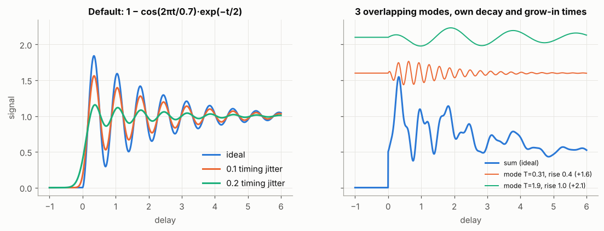
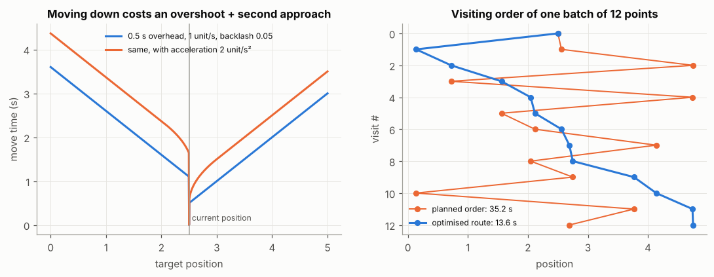
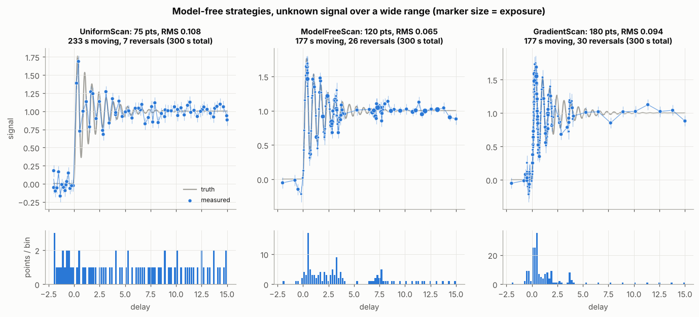
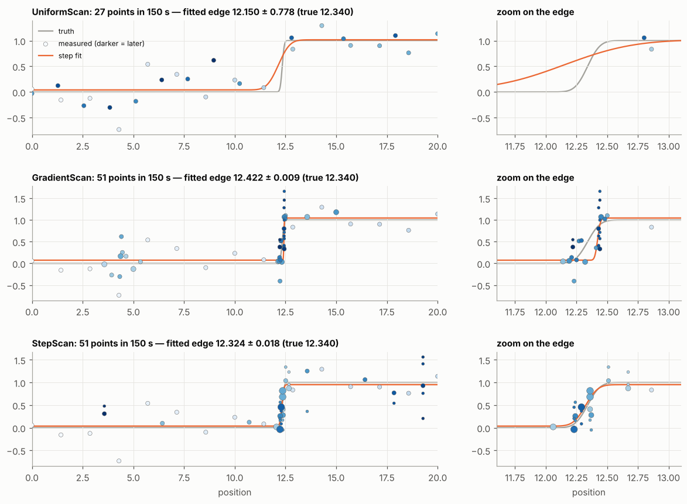
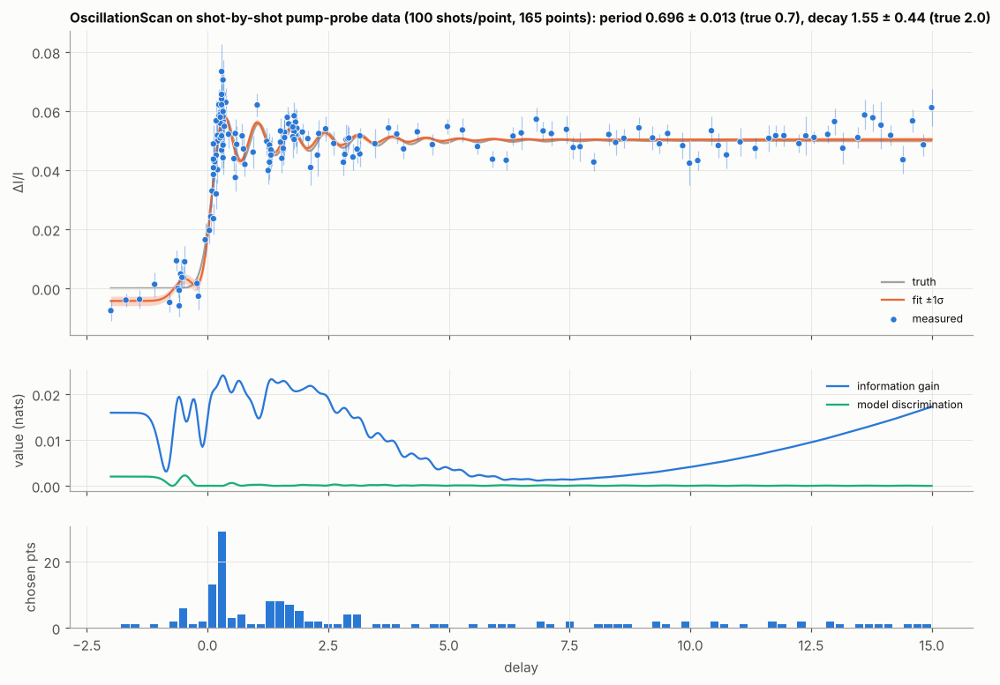
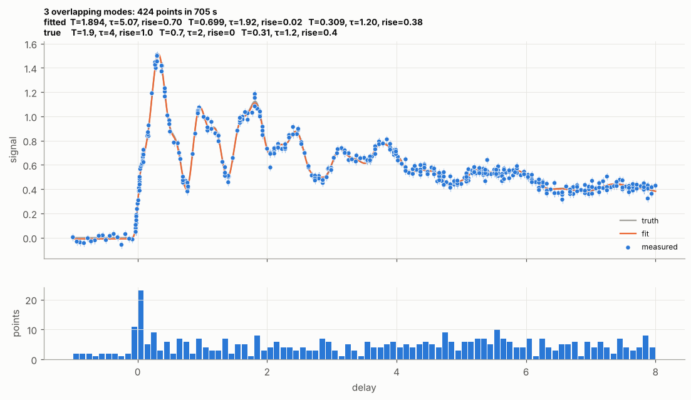
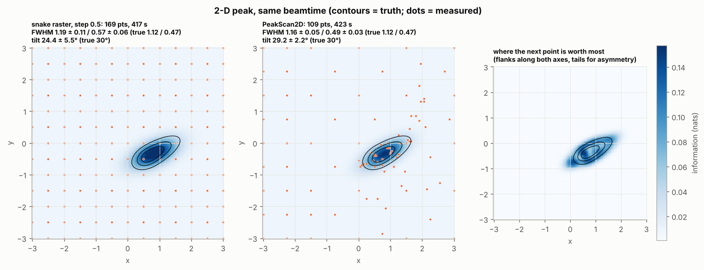
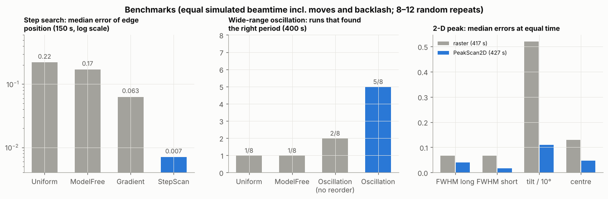

# Adaptive Scans

`escape.adaptive_scan` is a portfolio of strategies for deciding **where to
measure next** — and with which exposure, and in which order — when every
point costs time: moving a motor or delay stage, waiting for it to settle,
correcting backlash, and accumulating statistics.  Each strategy is given the
data so far (value ± error per position, and the exposure used) and returns
the next batch of points as an ordered plan.

```{note}
This submodule is optional and imported explicitly:

    from escape import adaptive_scan as ads

It needs only `numpy`/`scipy`.  Its signal model also drives the synthetic
test data of {func}`escape.storage.get_test_data`.
```

---

## Choosing a strategy

| strategy | assumes | learns / optimises | use when |
|---|---|---|---|
| {class}`~escape.adaptive_scan.UniformScan` | nothing | coarse-to-fine uniform coverage | baseline; signal fills the range evenly |
| {class}`~escape.adaptive_scan.ModelFreeScan` | a curve that is smooth between points | where linear interpolation is worst (noise-aware curvature) | first look at an unknown signal; anything without a model |
| {class}`~escape.adaptive_scan.GradientScan` | same | where the signal changes significantly (noise-aware slope) | locating and resolving edges / localised changes |
| {class}`~escape.adaptive_scan.StepScan` | an (error-function) step, optional recovery | step position, width, height, recovery | edge / time-zero / knife-edge searches |
| {class}`~escape.adaptive_scan.OscillationScan` | step + 1–3 damped oscillations, each with its own decay and grow-in time | time zero, jitter, frequencies, decay and rise times | coherent phonons / impulsive responses |
| {class}`~escape.adaptive_scan.PeakScan2D` | tilted, optionally asymmetric 2-D peak | centre, size (FWHM), tilt, asymmetry | beam profiles, 2-D rocking/alignment maps |

A natural progression is to start model-free (robust, no assumptions), then
switch to the model that the data reveal.  Data can be handed from one
strategy to another with `add()`, because every strategy accepts the same
measurements.

## The common loop

```python
from escape import adaptive_scan as ads

motion = ads.Axis(speed=2.0, overhead=0.5, backlash=0.05)   # see "Costs" below
scan = ads.ModelFreeScan((-1, 5), grid_step=0.02, motion=motion,
                         exposure=ads.ExposureModel("auto", base=1.0))

x = scan.initial_points()                    # coarse survey
scan.add(x, *measure(x))                     # value and 1σ error per point
while scan.n_points < 200:
    plan = scan.plan(5, position=current_motor_position)
    for pos, exposure in plan:               # already in the fastest order
        y, yerr = measure_one(pos, exposure)
        scan.add(pos, y, yerr, exposure=exposure)
```

* `plan(n)` returns a {class}`~escape.adaptive_scan.Plan`: `positions`,
  `exposures`, `move_times`, the expected value of each point and
  `total_time`.  Iterating gives `(position, exposure)` in measuring order.
* `next(position)` gives just the single next `(position, exposure)`.
* `add(..., refit=False)` defers refitting the model-based strategies, e.g.
  when points are added one by one within a batch.  Call `scan.fit()` after
  the batch.
* {func}`~escape.adaptive_scan.run_plan` runs the loop against a simulated
  {class}`~escape.adaptive_scan.Instrument` until a time budget is spent.

## Costs: grid, exposure, motion, order

Planning is shared by all strategies.  For every candidate position `x` and
allowed exposure `e`, the strategy's expected value `U(x, e)` (information,
or reduction of a model-free loss) is divided by the time it costs:

```text
rate(x, e) = U(x, e) / (move_time(current → x) + e + acquisition_overhead)
```

The best point is committed: the strategy updates its expectations as if the
point had been measured.  The next point is then chosen *from that position*,
so a batch is planned as a path.  The finished batch is put into the fastest
visiting order.  As a result, plans prefer nearby points, points in the
preferred approach direction, and the exposure that buys the most per
second.

**Grid.**  `grid_step=0.02` restricts all positions to multiples of the step
within the range, the grid that {func}`escape.utilities.roundto` produces.
The scan then only fills that grid.  Measuring a grid position again is
allowed: it adds statistics, combined by inverse-variance weighting where a
strategy averages.  For 2-D scans give one step per axis.  `candidates=`
accepts any explicit list of reachable positions.

**Exposure / statistics.**  {class}`~escape.adaptive_scan.ExposureModel`
lists the exposures the planner may choose (`"auto"` = `base × [½, 1, 2, 4, 8]`)
and models the noise of a point as

```text
noise(e) = sqrt(coeff² / e + floor²)
```

`coeff` and `floor` are estimated automatically from the measured errors.
`floor` is the part of the noise that more statistics cannot reduce (drifts),
and it is estimated once points with two or more exposures exist.  With a
floor, long exposures stop paying off, and the planner switches to more points
or other positions instead.

**Motion.**  {class}`~escape.adaptive_scan.Axis` models the time to move one
axis:

* `overhead` — fixed time per move (command latency, settling);
* `speed`, `acceleration` — trapezoidal travel profile, so short moves are
  relatively cheap;
* `backlash`, `direction` — positions approached against the preferred
  `direction` are overshot by `backlash` and approached again (a second
  move);
* `reverse_penalty` — an extra time for reverse moves, if that is how the
  axis behaves.

{meth}`Axis.calibrate(start, end, duration) <escape.adaptive_scan.Axis.calibrate>`
fits overhead, speed and reverse penalty to logged moves, so the costs can be
learnt from the beamline's own timing.  {class}`~escape.adaptive_scan.Motion`
combines axes for 2-D scans, moving them in parallel (time = slowest axis) or
one after another.  Without a motion model, moves are free and plans are not
reordered.

**Order.**  {func}`~escape.adaptive_scan.order_route` solves the asymmetric
travelling-salesman path (backlash makes `a → b` and `b → a` differ).  It is
exact up to 10 points and a 2-opt / or-opt heuristic above that, seeded with
monotone sweeps.  For a single axis with backlash this typically gives "sweep
up from here, then return once and sweep up again".

## The strategies

### Uniform baseline

{class}`~escape.adaptive_scan.UniformScan` measures the grid coarse to fine:
every 2ᵏ-th point, then the points in between, and so on.  Stopping at any
time leaves an even coverage.  Each pass runs in the preferred direction.

### Model-free: `ModelFreeScan` and `GradientScan`

Both look at the averaged data as a polyline and split the "worst" interval at
its middle grid position.  They are noise-aware: only the *significant* part
of a change counts, so pure noise does not attract points.

* **`ModelFreeScan`** (`loss="interpolation"`, default): the loss of an
  interval is its estimated linear-interpolation error `|y''|·dx²/8`.
  `y''` comes from second differences, shrunk by `kappa` standard errors.
  A `uniform_weight·dx` term keeps refining flat or noise-dominated regions
  slowly.  Point density follows the curvature, so extrema and oscillations
  are resolved.
* **`GradientScan`** (`loss="gradient"`): the loss is the polyline length,
  `sqrt(dx² + dy_sig²)` in normalised units, with
  `dy_sig = max(|Δy| − kappa·σ_Δy, 0)`; it is the `Learner1D` loss of the
  `adaptive` package, made noise-aware.  Density follows the slope, which is
  ideal for edges but under-samples extrema.

New points are valued with the reliability `s²/(s² + noise(e)²)` of a point
with exposure `e`, where `s` is half the change over the interval, so
needlessly short exposures are avoided.  Once an interval cannot be split any
further (grid resolution reached), its end points can be **re-measured** with
more statistics instead.  That is worth the change across the interval, times
the point's share of the noise, times the fractional noise reduction.
`max_loss()` measures convergence.

### Step search: `StepScan`

Model: a step `offset + A·Φ((t − t0)/σ)` (σ = jitter / beam size), optionally
with an exponential recovery (`recovery=True`).  While the step position is
uncertain, the distinct best positions of a grid search are kept as competing
hypotheses, and points go where they disagree.  This acts as a noise-aware
bisection.  Once the edge is found, points go to its flanks (position and
width), and with recovery also to the decay.

### Oscillations: `OscillationScan`

The signal model, {class}`~escape.adaptive_scan.ImpulsiveResponse`, is a sum
of {class}`~escape.adaptive_scan.Oscillation` components switched on at `t0`:

```text
y(t) = offset + Σ_k A_k · g_k(t) · exp(-(t-t0)/decay_k) · cos(2π (t-t0)/period_k + phase_k)
g_k(t) = 1 - exp(-(t - t0 - onset_k)/rise_k)      (grow-in, 0 before t0 + onset_k)
```

`period=np.inf` gives a non-oscillating step or exponential.  `response(t,
sigma=…)` is the signal convolved **exactly** with a Gaussian timing jitter:
every term is a step times a complex exponential, whose Gaussian convolution
has a closed form.

`OscillationScan(t_range, max_osc=3, fit_rise=True)` fits 0 … `max_osc`
overlapping oscillations.  Each has its own frequency, decay time and (with
`fit_rise`) grow-in time, plus the step/recovery components, `t0` and the
jitter `sigma` (unless given).  Fitting works as follows:

1. **Model order by BIC.**  Amplitudes and phases are linear and solved
   exactly (variable projection), so the optimiser only sees `t0`, `sigma`,
   rates, frequencies and rise times.  New oscillations start from peaks of a
   Lomb–Scargle periodogram of the residuals.
2. **Competing hypotheses.**  Distinct local optima within Δχ² = 25 are kept
   and weighted by BIC.  These are typically frequency aliases or, with
   `t0_modes=True`, time zero traded against the oscillation phase.
3. **Expected information gain** about the target parameters `S` (default:
   all time-structure parameters) from the linearised posterior Σ:

   ```text
   gain(t) = -½ log(1 - vᵀ Σ_SS⁻¹ v / (noise² + jᵀ Σ j)),   j = ∂model/∂params (t),  v = (Σ j)_S
   ```

   This is the D_s-optimal criterion.  It is *not* "more points where the
   signal is steep":

   * the sensitivity to `t0` is the slope;
   * the sensitivity to a frequency grows like `(t − t0)` times the
     oscillatory slope;
   * the sensitivity to a decay time peaks at the extrema, where the slope
     is zero;
   * a parameter that is already well known stops attracting points.
4. **Model discrimination**: a bonus `½ log(1 + Δμ² / (noise² + var₁ + var₂))`
   where hypotheses disagree.
5. **Exploration**: 30 % of the points are space-filling (`explore=0.3`).
   Without that share, the design can lock onto a wrong early model.

Read off results with `scan.estimates()` / `scan.summary()`.  They combine all
hypotheses of the best model order (mixture mean ± std) and derive periods
and decay times from the combined frequencies and rates.  `scan.best` is the
single best fit; its errors can be too small when competing solutions exist,
especially for `t0`.

Other options:

* `targets="frequencies"` concentrates on the frequencies;
* `sigma=0.2` fixes a known jitter;
* `recovery=False` makes the step pure (no recovery rate);
* `max_osc` and `fit_rise` set the model class.

With 500 points at noise 0.02, the fit separates 3 overlapping modes:

| | periods | decay times | rise times |
|---|---|---|---|
| true | 0.31 / 0.7 / 1.9 | 1.2 / 2 / 4 | 0.4 / 0 / 1.0 |
| fitted | 0.310 / 0.700 / 1.893 | 1.28 / 1.93 / 3.73 | 0.33 / 0 / 1.09 |

### 2-D peaks: `PeakScan2D`

{class}`~escape.adaptive_scan.Peak2D` is a tilted peak with *split* widths:

```text
u = cos a (x-x0) + sin a (y-y0),   v = -sin a (x-x0) + cos a (y-y0)
f = offset + A · exp(-u²/2su² - v²/2sv²),   su = su₋ (u<0) or su₊ (u>0), likewise sv
```

This is a skewed profile that stays smooth at the centre.
{func}`~escape.adaptive_scan.fit_peak2d` fits it from moment-based and
brightest-point starts.  It reports a canonical form: `u` is the major axis,
and the angle lies in [−90°, 90°).  `errors()` adds `fwhm_u`, `fwhm_v`,
`angle_deg` and the asymmetries `asym_u`, `asym_v` (= (s₊ − s₋)/(s₊ + s₋)).

`PeakScan2D(bounds, asymmetric="auto")` keeps a symmetric and an asymmetric
hypothesis, weighted by BIC, and measures where they differ.  `targets` may
be `"shape"` (default: centre, tilt, widths) or `"size"` (widths only).  Two
axes with their own speeds and backlash enter the plan through a
{class}`~escape.adaptive_scan.Motion`.

## Synthetic data and simulation

{func}`escape.storage.get_test_data` simulates shot-resolved pump-probe data
(I0 fluctuations, timetool jitter, pump drop-outs, slow drift, shot noise).
It accepts any `response`, arbitrary per-step `delays` and a `seed`.
{func}`~escape.adaptive_scan.pump_probe_points` reduces it to one value per
step (`R_on/R_off − 1`, with `R = Σi/Σi0`).

For trying strategies offline:

* {class}`~escape.adaptive_scan.PumpProbeSimulator` (that full chain;
  exposure in units of `shots_per_point`);
* {class}`~escape.adaptive_scan.GaussianSimulator` (any signal plus noise
  `sqrt(noise²/e + floor²)`, including 2-D);
* {class}`~escape.adaptive_scan.Instrument`, which adds a position and a clock
  that charges moves (with backlash), exposure and overhead.

```python
sim = ads.GaussianSimulator(ads.ImpulsiveResponse.default(), noise=0.05, sigma=0.1)
instr = ads.Instrument(sim, motion=motion)
scan = ads.OscillationScan((-1, 5), motion=motion, exposure=ads.ExposureModel("auto"))
ads.run_plan(scan, instr, budget=600)          # seconds of simulated beamtime
print(scan.summary(), instr.clock, instr.move_time, instr.n_reversals)
```

## Gallery

All figures are produced by `examples/adaptive_scan_gallery.py` (seeded
simulations; strategy comparisons use equal simulated beamtime).  Marker size
is the chosen exposure; grey lines are the true signal.



*Signal models: the default damped oscillation with and without timing jitter,
and three overlapping modes with their own decay and grow-in times.*



*Move times from position 2.5 with backlash correction (reverse moves cost an
overshoot and a second approach), and the same 12 points in the proposed order
(35.2 s) against the optimised route (13.6 s).*



*Model-free strategies over a wide range, 300 s each.  `ModelFreeScan` follows
the curvature and uses long exposures in the flat tail; `GradientScan` piles
points onto the steep flanks.*



*Step search, 150 s each (darker = measured later).  `StepScan` surveys, then
measures both flanks of the edge.*



*`OscillationScan` on shot-by-shot pump-probe data: fit, the value of the next
point, and where the points went.*



*Three overlapping modes with own rise and decay times.  The signal fills the
range, so apart from the onset the points spread evenly.*



*2-D peak at equal time: snake raster against `PeakScan2D`, and the value of
the next point.*



*Benchmark summary (see the tables below).*

## Benchmarks

All comparisons use **equal simulated beamtime**, including moves, a delay stage
with 0.5 s overhead per move, 1 unit/s travel, backlash correction against +
direction, and automatic exposure choice (½–8×).  Every strategy's data are
analysed with the same fit.  Medians over 8–12 random repeats; with that many
repeats, differences below roughly a factor of 1.5 are not significant.

**Step at an unknown position in (0, 20)**, width 0.08, noise 0.3 per unit
exposure, 150 s:

| strategy | error of step position | error of width | points | time moving |
|---|---|---|---|---|
| UniformScan | 0.22 | 0.062 | 27 | 83 % |
| ModelFreeScan | 0.17 | 0.059 | 47 | 59 % |
| GradientScan | 0.063 | 0.084 | 53 | 57 % |
| **StepScan** | **0.007** | **0.016** | 47 | 57 % |

**Damped oscillation in a wide range (−2, 15)**, period 0.7, jitter 0.15,
noise 0.008 per unit exposure with a 0.002 floor, 400 s; fraction of runs
recovering the period within ±0.05:

| strategy | period found | points | time moving |
|---|---|---|---|
| UniformScan | 1/8 | 125 | 70 % |
| ModelFreeScan | 1/8 | 200 | 45 % |
| **OscillationScan** | **5/8** | 135 | 64 % |
| OscillationScan without route ordering | 2/8 | 118 | 69 % |

The earlier benchmark with the shot-by-shot `PumpProbeSimulator` (no motion
costs, 100 shots/point) gave the same picture.  On (−2, 15) with 75 points,
the oscillation scan found the period in 44–63 % of runs, against 13 % for
uniform.  On the tight range (−1, 5) both were equal (75–100 %), because
there the signal fills the range evenly and uniform sampling is close to
optimal.

**Model-free reconstruction** (RMS error of the interpolated curve against
the truth, 200 s, noise 0.05):

| signal | UniformScan | GradientScan | **ModelFreeScan** |
|---|---|---|---|
| step | 0.041 | 0.037 | **0.034** |
| oscillation on (−1, 5) | 0.041 | 0.073 | **0.039** |
| oscillation on (−2, 15) | 0.144 | 0.141 | **0.049** |

The slope-driven `GradientScan` is good for edges but under-samples
oscillation extrema.  With 4× more noise, `ModelFreeScan` was 7 % worse than
uniform on the oscillation over (−1, 5).

**2-D peak** (tilted 30°…random, asymmetric, random position in a 6 × 6
area; y axis half as fast as x; noise 0.08):

| strategy | time | FWHM error (long / short) | tilt error | centre error |
|---|---|---|---|---|
| snake raster, step 0.5 | 417 s | 0.067 / 0.067 | 5.2° | 0.13 |
| snake raster, step 0.375 | 649 s | 0.072 / 0.039 | 1.2° | 0.15 |
| **PeakScan2D** | 427 s | **0.040 / 0.016** | **1.1°** | **0.047** |
| PeakScan2D | 255 s | 0.22 / 0.067 | 7.2° | 0.17 |

With enough time, the adaptive 2-D scan beats a raster of the same and of 1.5×
the duration.  With too little time (about 60 points, of which 25 are the
survey), it has not yet converged.


```{warning}
Every model-based strategy is only as good as its model class.  A component
outside it (a fourth oscillation, a second peak) is found only through the
space-filling share and the residual periodogram.  Keep `explore > 0`, start
with a survey spread over the range (or with `ModelFreeScan`), and check the
residuals.
```
